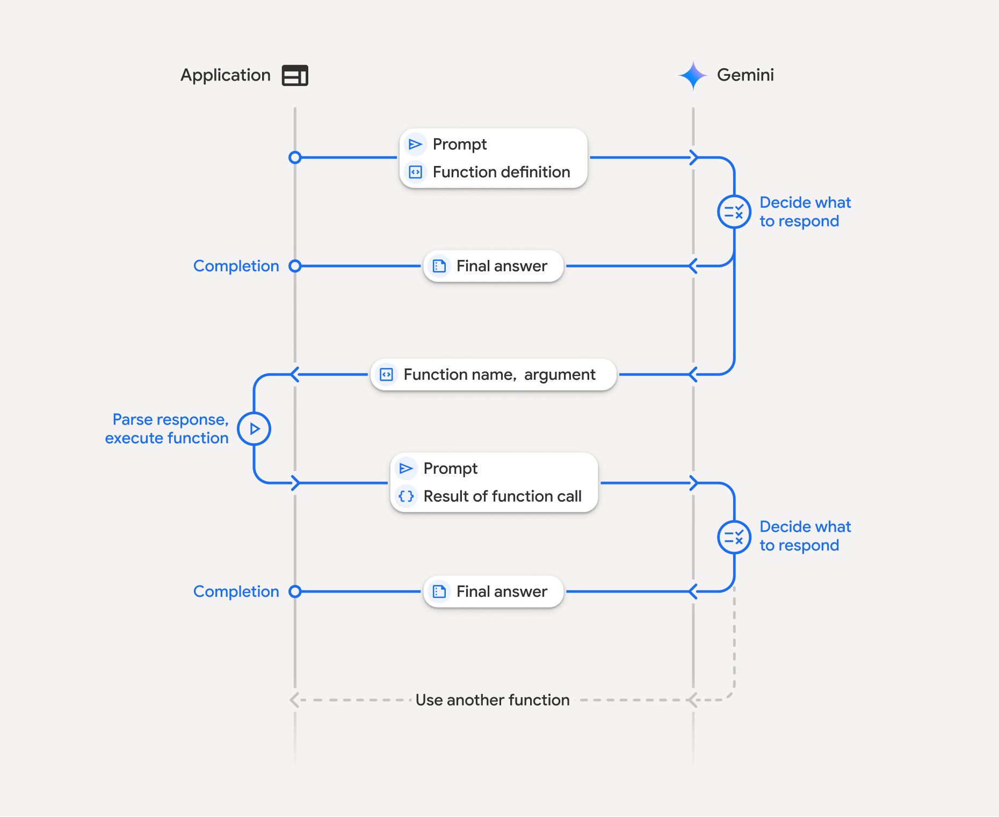

# Table of Contents

- [Useful Mental Model](#useful-mental-model)
- [LLM vs Chatbot vs Agent](#llm-vs-chatbot-vs-agent)
- [Prompts, Instructions & Context](#prompts-instructions--context)
- [Tool Calling / Function Calling _(Pending)_](#tool-calling--function-calling-)
- [Structured Output _(Pending)_](#structured-output)
- [Agent Loop](#agent-loop)
- [Reasoning vs Planning](#reasoning-vs-planning)
- [Deterministic Workflow vs Agentic Workflow](#deterministic-workflow-vs-agentic-workflow)
- [State vs Memory vs Conversation Context](#state-vs-memory-vs-conversation-context)
- [Embeddings](#embeddings)
- [Vector Databases](#vector-databases)
- [RAG (Retrieval-Augmented Generation)](#rag-retrieval-augmented-generation)
- [Multi-Agent Systems](#multi-agent-systems)
- [Human-in-the-loop](#human-in-the-loop)
- [MCP (Model Context Protocol)](#mcp-model-context-protocol)
- [A2A (Agent-to-Agent or Agent2Agent)](#a2a-agent-to-agent-or-agent2agent)
- [Core concepts of AI agents](#core-concepts-of-ai-agents)
- [Resources](#resources)

# Useful Mental Model

```
                    ┌───────────────┐
                    │      LLM      │
                    │   "reasoning" │
                    └───────┬───────┘
                            │
                    ┌───────▼───────┐
                    │     Agent     │
                    │ instructions  │
                    │ tools         │
                    │ state         │
                    └───────┬───────┘
                            │
             ┌──────────────┼──────────────┐
             │              │              │
             ▼              ▼              ▼
          Tool/API        Memory       Other Agent
```

Google’s current framing: **An agent combines the model, tools, grounding/data, orchestration, state/memory, and a runtime to accomplish multi-step goals.**

# LLM vs Chatbot vs Agent

An LLM is essentially the model:

```
Prompt
  ↓
LLM
  ↓
Generated response
```

A traditional chatbot adds conversational context:

```
User
 ↓
Conversation history
 ↓
LLM
 ↓
Response
```

An agent adds the ability to decide what actions are required:

```
User goal
   ↓
 Agent
   │
   ├── Reason / plan
   ├── Call tools
   ├── Inspect result
   ├── Call another tool
   └── Produce final answer
```

[As per Google](https://ai.google.dev/api/agents): Agents are systems that leverage models, a set of tools, and reasoning capabilities to perform complex, multi-step tasks and achieve specific goals. Unlike a single model call, an agent can plan, execute a series of actions, interact with external systems, and synthesize information to fulfill a user's request

Simple example:

```
User:
"Find the weather in Kolkata and tell me whether I should carry an umbrella."

Normal LLM:
May try to answer from existing knowledge.

Agent:
1. Understands it needs current weather data
2. Calls get_weather("Kolkata")
3. Reads precipitation forecast
4. Reasons over result
5. Responds
```

# Prompts, Instructions & Context

We understand that an LLM usually receives more than just _"What is the weather?"_

The effective request can look conceptually like this -

```
System instruction:
"You are a travel assistant."

Developer/application instructions:
"Always provide concise recommendations."

Conversation:
User: I'm visiting Jaipur.
Assistant: ...

Current request:
User: What should I do tomorrow?

Tool results:
Weather: 37°C
```

All of this contributes to the model's context.

The key components here are -

- **System/Developer Instructions**: "behind-the-scenes" ground rules set by the app/agent creator. It tells the model who it is, how to behave, what tone to use, what it is forbidden to do etc. Example: _You are a helpful coding assistant. Always respond in concise Python and never reveal user passwords._
- **User Prompts**: the actual message, query/question, or task we send to the model.
- **Conversation History**: chronological log of past messages exchanged between us and the AI in the current chat. Since AI models are naturally stateless, this history logs provide context to the model.
- **Tool Results**: raw data returned by an external program, API, or database when the AI decides it needs to call/use a tool. Model does not call tools, the agents does it for the model and send back the results along with the conversation history.
- **Context Window**: the total capacity of information the model can look at, at one single instant. We now understand that system/developer instructions, past conversations, new prompt, and tool results etc. everything add up as the total capacity.
- **Token Limits**: the hard boundary on how much text the model can read and generate. Models work with tokens, the token limit defines the maximum token count allowed within that context window before text gets cut off.

Important takeaway -

> An agent's behavior depends heavily on its instruction plus the context supplied to the model.

# Tool Calling / Function Calling 🚨

Single most important prerequisite concept for ADK.

Imagine this Python function -

```python
def get_order(order_id: str) -> dict:
  return {
    "order_id": order_id,
    "status": "SHIPPED"
  }
```

We make this function available to the LLM.

The user asks:

```
"Where is order 123?"
```

The process becomes:

```
User
 ↓
"Where is order 123?"
 ↓
LLM
 ↓
"I need get_order"
 ↓
Function call:
get_order(order_id="123")
 ↓
Your application executes function
 ↓
{
  "status": "SHIPPED"
}
 ↓
Result returned to LLM
 ↓
"Order 123 has been shipped."
```

One subtle but very important point:

> The LLM itself generally does not magically execute our Python function.

The model generates a structured tool/function call; our application/framework executes the corresponding code and passes the result back to model. [Google's documentation explicitly describes this lifecycle.](https://ai.google.dev/gemini-api/docs/function-calling)

In the above link, focus on -

```
Function declaration
        ↓
Model chooses function
        ↓
Structured arguments
        ↓
Application executes function
        ↓
Function result
        ↓
Model produces response
```

Function calling has 3 primary use cases -

- **Take Actions**: interact with external systems using APIs, such as scheduling appointments, creating invoices, sending emails, or controlling smart home devices; [example](https://ai.google.dev/gemini-api/docs/function-calling#meeting)
- **Augment Knowledge**: access information from external sources like databases, APIs, and knowledge bases; [example](https://ai.google.dev/gemini-api/docs/function-calling#weather)
- **Extend Capabilities**: use external tools to perform computations and extend the limitations of the model, such as using a calculator or creating charts; [example](https://ai.google.dev/gemini-api/docs/function-calling#chart)

## [How Function Calling Works](https://ai.google.dev/gemini-api/docs/function-calling#how-it-works)

Depiction from Google Gemini API docs -



It involves a structured interaction between our application, the model, and external functions -

- **Define Function Declaration**: define function's name, parameters, and purpose to the model
- **Call LLM with function declarations**: send user prompt along with the function declaration(s) to the model
- **Execute Function Code (Our Responsibility)**: the model _doesn't_ execute the function itself. We must extract the name and args, and execute it in our application
- **Create User friendly response**: send the result back to the model for a final user-friendly response.

This process can be repeated over multiple turns. The model supports calling multiple functions in a single turn (**parallel function calling**) and in sequence (**compositional function calling**).

### [Step 1: Define a Function Declaration](https://ai.google.dev/gemini-api/docs/function-calling#step-1)

```python
set_light_values_declaration = {
  "type": "function",
  "name": "set_light_values",
  "description": "Sets the brightness and color temperature of a light.",
  "parameters": {
    "type": "object",
    "properties": {
      "brightness": {
        "type": "integer",
        "description": "Light level from 0 to 100",
      },
      "color_temp": {
        "type": "string",
        "enum": ["daylight", "cool", "warm"],
        "description": "Color temperature",
      },
    },
    "required": ["brightness", "color_temp"],
  },
}

def set_light_values(brightness: int, color_temp: str) -> dict:
  """Set the brightness and color temperature of a room light."""
  return {"brightness": brightness, "colorTemperature": color_temp}
```

### [Step 2: Call the Model with Function Declarations](https://ai.google.dev/gemini-api/docs/function-calling#step-2)

```python
from google import genai

client = genai.Client()

interaction = client.interactions.create(
  model="gemini-3.7-flash",
  input="Turn the lights down to a romantic level",
  tools=[set_light_values_declaration],
)

# Python generator expression - iterates over every step inside interaction.steps and filters where type = function_call
# next() - built-in Python function, grabs the grabs the first matching item produced by the generator and stops scanning immediately
fc_step = next(s for s in interaction.steps if s.type == "function_call")
print(fc_step)
```

The model returns a `function_call` step with `type`, `name`, and `arguments` -

```
type='function_call'
name='set_light_values'
arguments={'color_temp': 'warm', 'brightness': 25}
```

### [Step 3: Execute the Function](https://ai.google.dev/gemini-api/docs/function-calling#step-3)

```python
fc_step = next(s for s in interaction.steps if s.type == "function_call")

if fc_step.name == "set_light_values":
  result = set_light_values(**fc_step.arguments) # **fc_step.arguments = dictionary unpacking operator, similar to JavaScript spread operator (...)
  print(f"Function execution result: {result}")
```

### [Step 4: Send Result Back to Model](https://ai.google.dev/gemini-api/docs/function-calling#step-4)

```python
final_interaction = client.interactions.create(
  model="gemini-3.7-flash",
  input=[
    {
      "type": "function_result",
      "name": fc_step.name,
      "call_id": fc_step.id,
      "result": [{"type": "text", "text": json.dumps(result)}],
    }
  ],
  tools=[set_light_values_declaration],
  previous_interaction_id=interaction.id, # Stateful
)

print(final_interaction.output_text)
```

### [Stateless Function Calling](https://ai.google.dev/gemini-api/docs/function-calling#stateless-function-calling)

We can also use function calling in stateless mode by managing the conversation history on the client side and setting `store=false`.

In stateless mode, we must pass the full history of the conversation in the `input` field of each subsequent request. This history must include -

1. The initial `user_input` step
2. All model-generated steps returned in Turn 1 (including `thought` and `function_call` steps) exactly as received
3. The `function_result` step containing the output of our executed function

```python
from google import genai
import json

client = genai.Client()

history = [
  {
    "type": "user_input",
    "content": [{"type": "text", "text": "Turn the lights down to a romantic level"}]
  }
]

# 1
interaction = client.interactions.create(
  model="gemini-3.7-flash",
  store=False, # Stateless
  input=history,
  tools=[set_light_values_declaration],
)

# 2
for step in interaction.steps:
  history.append(step.model_dump())

fc_step = next(s for s in interaction.steps if s.type == "function_call")
if fc_step.name == "set_light_values":
  result = set_light_values(**fc_step.arguments)

# 3
history.append({
  "type": "function_result",
  "name": fc_step.name,
  "call_id": fc_step.id,
  "result": [{"type": "text", "text": json.dumps(result)}],
})

final_interaction = client.interactions.create(
  model="gemini-3.7-flash",
  store=False,
  input=history,
  tools=[set_light_values_declaration],
)

print(final_interaction.output_text)
```

### [Parallel Function Calling](https://ai.google.dev/gemini-api/docs/function-calling#parallel_function_calling)

Call multiple functions at once when they are independent.

```python
power_disco_ball = {"type": "function", "name": "power_disco_ball", "description": "Powers the disco ball.",
    "parameters": {"type": "object", "properties": {"power": {"type": "boolean"}}, "required": ["power"]}}
start_music = {"type": "function", "name": "start_music", "description": "Play music.",
    "parameters": {"type": "object", "properties": {"energetic": {"type": "boolean"}, "loud": {"type": "boolean"}}, "required": ["energetic", "loud"]}}
dim_lights = {"type": "function", "name": "dim_lights", "description": "Dim the lights.",
    "parameters": {"type": "object", "properties": {"brightness": {"type": "number"}}, "required": ["brightness"]}}

client = genai.Client()

interaction = client.interactions.create(
  model="gemini-3.7-flash",
  input="Turn this place into a party!",
  tools=[power_disco_ball, start_music, dim_lights],
  generation_config={"tool_choice": "any"},
)

for step in interaction.steps:
  if step.type == "function_call":
    args = ", ".join(f"{key}={val}" for key, val in step.arguments.items())
    print(f"{step.name}({args})")
```

### [Compositional Function Calling](https://ai.google.dev/gemini-api/docs/function-calling#compositional_function_calling)

Chain multiple function calls together for complex requests. Example: get location first, then get weather for that location.

```python
get_weather_forecast_declaration = {
  "type": "function",
  "name": "get_weather_forecast",
  "description": "Gets the current weather temperature for a given location.",
  "parameters": {
    "type": "object",
    "properties": {
      "location": {"type": "string", "description": "The location"},
    },
    "required": ["location"],
  },
}

set_thermostat_temperature_declaration = {
  "type": "function",
  "name": "set_thermostat_temperature",
  "description": "Sets the thermostat to a desired temperature.",
  "parameters": {
    "type": "object",
    "properties": {
      "temperature": {
        "type": "integer",
        "description": "The temperature in Celsius",
      },
    },
    "required": ["temperature"],
  },
}

client = genai.Client()

interaction = client.interactions.create(
  model="gemini-3.7-flash",
  input="If it's warmer than 20°C in London, set the thermostat to 20°C, otherwise 18°C.",
  tools=[
    get_weather_forecast_declaration,
    set_thermostat_temperature_declaration,
  ],
)

for step in interaction.steps:
  if step.type == "function_call": # tool/function call requested by the model
    print(f"Function to call: {step.name}") # specific function to invoke
    print(f"Arguments: {step.arguments}") # parameters/arguments to be passed to the function
  elif hasattr(step, "content") and step.content: # if step contains content attribute and non-empty (model produced text content)
    for part in step.content: # loop through individual pieces/parts of the message content
      if hasattr(part, "text"): # if the part have text, the print it
        print(part.text)
```

### [Function Calling Modes](https://ai.google.dev/gemini-api/docs/function-calling#function_calling_modes)

Control how the model uses tools using `tool_choice` in `generation_config`:

- `auto` (default): Model decides whether to call a function or respond directly
- `any`: Model is constrained to always predict a function call
- `none`: Model is prohibited from making function calls
- `validated`: Model ensures function schema adherence

```python
generation_config = {
  "tool_choice": {
    "allowed_tools": {
      "mode": "any",
      "tools": ["get_current_temperature"]
    }
  }
}
```

### [Multi-tool use](https://ai.google.dev/gemini-api/docs/function-calling#native-tools)

# Structured Output

Normally an LLM might return -

```
"The customer's order ID is 123 and it was shipped."
```

But applications often need -

```json
{
  "orderId": "123",
  "status": "SHIPPED"
}
```

That's structured output.

A response from model like `LLM → arbitrary prose` is difficult for software to reliably consume compared with -

```
LLM
 ↓
Schema
 ↓
{
  "intent": "ORDER_STATUS",
  "order_id": "123"
}
```

[Gemini supports structured outputs specifically for machine-consumable JSON responses.](https://ai.google.dev/gemini-api/docs/structured-output) We can configure Gemini models to generate responses that adhere to a provided JSON Schema. This ensures predictable, type-safe results and simplifies extracting structured data from unstructured text.

Structured outputs is ideal for -

- **Data extraction**: pull specific information like names and dates from text
- **Structured classification**: classify text into predefined categories
- **Agentic workflows**: generate structured inputs for tools or APIs

In addition to supporting JSON Schema in the REST API, the Google GenAI SDKs allow defining schemas using [Pydantic](https://docs.pydantic.dev/latest/) (Python) and [Zod](https://zod.dev/) (JavaScript).

# Agent Loop

This concept separates an agent from a single LLM call.

A simplified loop is -

```
             ┌────────────────┐
             │      Goal      │
             └───────┬────────┘
                     ↓
             ┌────────────────┐
             │ Think/Determine│
             │ next action    │
             └───────┬────────┘
                     ↓
              Need a tool?
               /        \
             Yes         No
              ↓           ↓
         Execute tool   Answer
              ↓
         Observe result
              │
              └───────────────┐
                              ↓
                    Determine next action
```

Example -

```
User:
"Should I cancel my flight tomorrow?"

Agent:

1. Need booking details
   ↓
   get_booking()

2. Need cancellation rules
   ↓
   get_fare_rules()

3. Need current weather?
   ↓
   get_weather()

4. Combine information

5. Recommend action
```

The loop might perform one tool call or twenty.

This is one reason agent applications require controls around -

- maximum steps
- cost
- timeouts
- authorization
- failure handling

# Reasoning vs Planning

**Chain of Thought (CoT)**: is a prompt engineering and model training technique that helps LLM's handle complex logic. Instead of jumping straight to an answer, the model breaks a problem down into small, step-by-step intermediate thoughts (acts like a scratchpad) which greatly improves accuracy in math, coding, and multi-step reasoning.

**Reasoning**

Choosing an appropriate conclusion from information -

```
Weather:
Thunderstorms expected

Flight:
High probability of disruption

        ↓

Conclusion:
Allow extra airport time
```

**Planning**

Breaking a goal into tasks -

```
Goal:
Plan my weekend in Goa

        ↓

1. Determine weather
2. Find attractions
3. Determine travel distances
4. Build itinerary
5. Check conflicts
```

Agents frequently combine both _reasoning_ & _planning_.

Our application should usually care more about **observable actions and outcomes** than about exposing hidden model reasoning.

# Deterministic Workflow vs Agentic Workflow

This becomes extremely important when we reach ADK workflow agents.

Suppose our application must -

```
Validate Order
     ↓
Take Payment
     ↓
Create Shipment
```

If these steps must always happen in exactly that order, no need to ask an LLM to decide everything. We can use a deterministic workflow -

```
Step A
 ↓
Step B
 ↓
Step C
```

**An agentic flow is more appropriate when the next step depends on the situation -**

```
Customer query
     ↓
   Agent
     │
     ├── Maybe query order DB
     ├── Maybe search KBA
     ├── Maybe query logistics
     └── Maybe escalate
```

A mature agent system frequently combines the two.

Google ADK explicitly supports both predictable workflow orchestration and dynamic, agent-controlled routing.

> 🚨 The takeaway here is that not every workflow requires LLM calls. First evaluate if the steps are always same, or does it vary with situation.

# State vs Memory vs Conversation Context

**Conversation Context**: information currently supplied to the model -

```
User: My name is John.
Assistant: Hi John.
User: What is my name?
```

The model knows users name because the previous conversation is currently in context.

**State**: structured information maintained by our application/session -

```python
state = {
  "customer_id": "C123",
  "current_order": "O456",
  "workflow_step": "PAYMENT"
}
```

**Memory**: information retained and retrieved across longer periods/sessions -

```
User preference: Vegetarian

Preferred airport: CCU

Previous trip: Tokyo
```

# Embeddings

Suppose we have: "How do I reset my password?"

And, a document says "Steps to recover account credentials".

Keyword matching may miss the relationship. An embedding converts semantic meaning into vectors -

```
Text
 ↓
Embedding model
 ↓
[0.12, -0.82, 0.33, ...]
```

Semantically similar texts usually end up relatively close in the vector space.

# Vector Databases

Once we have embeddings, we need somewhere to store and search them.

Conceptually -

```
Documents
 ↓
Chunks
 ↓
Embeddings
 ↓
Vector Database
```

Then -

```
Question
 ↓
Embedding
 ↓
Similarity search
 ↓
Most relevant chunks
```

Common products include -

- Pinecone
- Weaviate
- Milvus
- pgvector
- Vertex AI Vector Search

# RAG (Retrieval-Augmented Generation)

In simple terms, RAG is the process of retrieving authoritative knowledge details (usually not included in its training data), supplying it to the model, so that it can optimize the response in the context of the authoritative knowledge shared.

Without RAG -

```
Question
    ↓
   LLM
    ↓
Answer based primarily on model knowledge/context
```

With RAG -

```
Question
   ↓
Search knowledge base
   ↓
Retrieve relevant documents
   ↓
Question + documents
   ↓
LLM
   ↓
Grounded answer
```

Example -

```
Employee:
"How many casual leaves do I have?"

                    Agent
                      │
          ┌───────────┴─────────┐
          ↓                     ↓
    HR Policy RAG           HR System
          │                     │
Policy says entitlement     Balance = 7
          │                     │
          └───────────┬─────────┘
                      ↓
                    Answer
```

In Agentic RAG, Agent decides whether, where and how to retrieve.

# Multi-Agent Systems

A single agent may have twenty different tools -

```
Mega Agent
 ├── HR
 ├── Finance
 ├── CRM
 ├── ERP
 ├── Email
 ├── Tickets
 ├── Search
 └── ...
```

Eventually this becomes difficult to reason about, and maintain.

Instead, we should have -

```
                    Coordinator
                         │
             ┌───────────┼───────────┐
             ▼           ▼           ▼
         HR Agent    Finance Agent   IT Agent
             │           │           │
          HR tools    ERP tools    IT tools
```

Each agent can have -

- specialized instructions
- specialized tools
- specialized permissions
- specialized context

# Human-in-the-loop

Agents sometimes need to stop and ask for human approval.

```
Agent
 ↓
Determine refund = ₹35,000
 ↓
Prepare refund
 ↓
       STOP
        ↓
Human approval
     /       \
 Approved   Rejected
    ↓
Execute refund
```

Human approval becomes especially important for -

- money movement
- deleting data
- sending external communications
- production changes
- privileged actions
- legal decisions
- sensitive information (security)

# MCP (Model Context Protocol)

MCP lets an AI application interact with external tools/resources through a standardized protocol.

Think it like this -

```
Agent
  │
  │ MCP
  ▼
MCP Server
  │
  ├── tool: search_orders
  ├── tool: create_ticket
  ├── resource: documentation
  └── resource: configuration
```

Instead of every AI application inventing a custom integration mechanism like -

```
Agent → custom integration → GitHub
Agent → custom integration → DB
Agent → custom integration → ERP
```

MCP aims for -

```
             Agent
               │
              MCP
        ┌──────┼──────┐
        ▼      ▼      ▼
      GitHub   DB     ERP
```

# A2A (Agent-to-Agent or Agent2Agent)

It is an open communication standard that lets different AI agents talk, share context, and delegate tasks to each other.

A useful distinction is -

**Tool/function calling:**

```
Agent
 ↓
Tool/API
```

**MCP:**

```
Agent
 ↓
MCP server
 ↓
Tools/resources
```

**A2A:**

```
Agent
 ↓
Another autonomous agent
```

Example -

```
Travel Agent
      │
     A2A
      ↓
Flight Booking Agent
```

# [Core concepts of AI agents](https://cloud.google.com/resources/core-concepts-ai-agents)

- **Models**: the reasoning engine that the agent uses to think with
- **Grounding**: the knowledge base, which becomes the mechanism for factual accuracy and knowledge retrieval
- **Tools**: defined capabilities for performing tasks, which determine what an agent can do
- **Data architecture**: where the agent stores its memory and data
- **Orchestration**: how the agent plans and connects all the parts in a multi-step task
- **Runtime**: where the agent lives and executes at scale

## Models

- It's the agent’s brain, reads and understands our requests, figures out what needs to happen, and generate smart responses
- Choosing the right model is a matter of balancing capability, speed, and cost for our use case. Optimize for efficiency instead of maximized raw power in all scenarios
- Robust cognitive architectures uses multiple specialized agents, dynamically choosing the leanest model for a specific sub-task. Example: powerful model for complex planning and reasoning, simpler model for high-volume tasks. **This dynamic model routing is key for optimizing both performance and cost**
- The chosen model(s) may have the option to fine-tune it, making its knowledge and style specialized to our specific business needs. Usually done using a curated dataset of our own high-quality examples. Review model's documentation and license agreement to find out if a model permits and supports fine-tuning.

## Grounding

An agent's credibility and usefulness depends on its ability to provide accurate, trustworthy answers based on verifiable facts. This is where grounding comes in. It transforms agents into true workflow automators that are deeply and accurately grounded in our business data.

When it comes to grounding, there are three layers to consider -

_1. RAG: A foundational first step_

- Retrieval-augmented generation (RAG) connects an agent to a verifiable source, real time data - ensuring the agent acts on truth, not hallucinations
- This retrieve-then-generate process can be applied to text, images, and other types of data
- It enables fast searches of massive datasets, leading to responsive, timely decisions
- **RAG falls short on complex queries that requires a deeper understanding of the relationships between data points**

_2. GraphRAG: Smarter Grounding_

- GraphRAG enables understanding the explicit relationships between data points in a knowledge graph
- Retrieves contextual data that better reflects its interconnections with other data sources
- So, instead of just matching similar phrases, our agent understands how concepts relate
- **While standard RAG relies on model-generated patterns, a knowledge graph allows us to define and manage the specific relationships between entities, ensuring that the agent respects our organization’s unique taxonomy and rules**
- For maximum reliability, organizations generally use a hybrid approach — combining the broad retrieval of standard RAG with the precision and control of GraphRAG

Example use case (Enterprise IT Support Agent) -

Scenario: A company builds an agentic AI assistant to help employees resolve IT issues (e.g., "My VPN keeps disconnecting when I'm on the finance team's shared drive").

Why plain RAG isn't enough?

A standard vector-based RAG system would retrieve chunks of text that are semantically similar to the query — like, a few VPN troubleshooting docs. But it has no understanding of how things relate, which server the finance drive lives on, which network policies apply to that server, who or what team owns that policy, or what past incidents were linked to it. So, the agent might ground its answer in the wrong document or miss a critical dependency.

How GraphRAG helps here?

The company might build a knowledge graph like -

```
Employee --works_on--> Finance Team
Finance Team --uses--> Shared Drive X
Shared Drive X --hosted_on--> Server ABC123
Server ABC123 --governed_by--> VPN Policy VPN456
VPN Policy VPN456 --known_issue--> "Disconnects under high load"
VPN Policy VPN456 --owned_by--> Network Team
```

When the agent gets the query, instead of just doing a similarity search, it now -

- Extracts entities from the query (like Employee, VPN, Finance shared drive)
- Traverses the graph to find connected nodes — Server ABC123, VPN Policy VPN456, the known issue, and the responsible team
- Pulls only the relevant subgraph + associated text chunks as grounding context
- Feeds that structured context to the LLM to generate the answer

Why this matters for an agentic workflow specifically?

If the agent needs to take multi-step action — e.g., "check current server load, then escalate to Network Team if the known issue is active" — the graph gives it a reliable map of who/what to act on next, not just text to summarize. Each hop in the graph is an auditable, explainable reasoning step, which is much harder to get from flat vector retrieval alone.

**Core benefit in one-liner: Vector RAG grounds the agent in _relevant text_. GraphRAG grounds it in _relevant text + verified relationships_, which is what agentic workflows generally requires when they have to reason across multiple connected facts before acting.**

_3. Agentic RAG: Dynamic Reasoning and Retrieval_

- Currently the most powerful approach to grounding is Agentic RAG
- Here the agent is no longer a passive recipient of information, but it is an active, reasoning participant in the retrieval process itself
- With Agentic RAG, an agent can analyze a complex query, formulate a multi-step plan, and execute multiple tool calls in sequence to find the best possible information
- This is not a replacement for traditional search, rather it adds advanced reasoning on top of the existing RAG and knowledge graph infrastructure in order to resolve multi-hop queries
- By empowering the agent to be an active, reasoning participant, we developers can build systems capable of executing the complex, multi-step queries and long-horizon tasks that define next-generation agentic capabilities

**Pro tip: Use the _retrieve and re-rank_ approach**

- Recall = finding all relevant documents
- Precision = ensuring retrieved documents are relevant
- Address the trade-off between recall & precision using the “retrieve and re-rank” approach
- This widens the recall window to retrieve a larger-than-needed set of documents
- Pass this large set to the LLM, or to a specialized re-ranking service, which will identify the most relevant documents and discard any that are irrelevant or semantically opposite

**Note: Fine-tuning is _NOT_ Grounding**

- Fine-tuning adapts a model’s style and refines its knowledge on a specific task
- Grounding connects the model to real-time, verifiable data sources to ensure its responses are factually accurate

## Tools

- Tools are defined capabilities which enables an agent to do more than the native functions of its core reasoning model
- Tools bridge the gap between the agent’s reasoning and its ability to act
- Using tools agents can perform a simple internal calculation, or interact with external systems using API calls
- Since [grounding](#grounding) is the primary way an agent retrieves new information, it is technically the most foundational tool in an agent’s toolkit

Tools can include -

- **Internal functions and services:** proprietary logic or specialized code which solves business-specific problems
- **External APIs:** secure connections to third-party services, allow agent to execute tasks in the real world
- **Data retrieval and grounding:** ability to dynamically query databases (including natural language to SQL), search vector stores, access enterprise knowledge bases. These tools ensure the agent’s actions are based on verifiable data
- **Agent collaboration:** one agent collaborate with another specialized agent to solve a problem. An agent can be used just as a “tool” for a specific task, or as collaborators that securely coordinate actions across different domains (which is usually done in enterprises).

To understand on Tool Calling / Function Calling, [refer here](#tool-calling--function-calling-).

## Data Architecture

- Agents use different types of memory for different tasks
- A robust enterprise data architecture must address three distinct needs -
   - persistent storage for long-term knowledge retrieval
   - low-latency access for short-term conversational context
   - a durable ledger for transactional auditing

_1. Long-term knowledge base (grounding and memory)_

Long-term memory is the foundation for an agent’s intelligence, grounding, and personalization. It is different from the fast, short-term context of a live conversation. Its architecture has three core components -

- A structured knowledge base for fact-based RAG
- A persistent store for distilled user preferences. The agent generates and stores salient facts about the user, team, or task to enable a continuous, personalized experience
- An operational data lake for raw material like conversation transcripts and workflow states, enabling more complex cognitive processes and future analytics

**Use case: Gaining access to all relevant information**

A legal agent retrieving case laws, internal policy documents, and training manuals to generate a legally compliant first draft of a contract.

_2. Working memory (conversational context and short-term state)_

This layer manages the transient information (the LLM context window) required for an ongoing task or conversation. It must provide extremely low-latency access to the iterative sequence of actions and observations made, to maintain responsive user experience.

**Use case: Having a helpful conversation**

A customer support agent maintaining the state of a multi-step troubleshooting workflow, remembering user’s previously provided serial numbers or diagnosis steps to prevent repetition.

_3. Transactional memory (state management and action auditing)_

This layer is responsible for recording actions and state changes with **strong consistency and integrity**. It will serve as the durable system of record, which is essential from a security standpoint and for delivering a non-repudiable (cannot be legitimately denied or rejected by the originator or any involved party) audit trail for every agent-driven action.

**Use case: Maintaining a durable ledger**

A supply chain agent records the successful execution of a complex, multi-party purchase order, ensuring the transaction is permanently tracked and verifiable across financial systems.

## Orchestration

It guides an agent through a multi-step task. For any process that requires more than just a single action (which is a very likely scenario), this helps to determine which tools are needed, in what sequence, and how their outputs should be combined to achieve the final goal.

A common and effective orchestration pattern is **ReAct (Reason + Action)**. This framework synergizes/combines the reasoning and acting capabilities of large language models, and establishes a dynamic, multi-turn loop where the model generates both reasoning traces (thoughts) and task-specific actions in an interleaved manner.

With ReAct, the reasoning helps the model track and update action plans, while actions gather information from external tools to inform the reasoning process. Here’s how it works -

- **Reason:** the agent assesses the goal and the current state, forming a hypothesis about the next best step and whether a tool is required
- **Act:** the agent selects and invokes the appropriate tool
- **Observe:** the agent receives the output from the tool. This new information is added into the agent’s context and feeds into the next Reason step of the cycle

**Use cases:**

- **Cross-departmental HR automation:** to onboard a new employee, the agent sequentially initiates actions across multiple systems. First, it creates an employee record in the system; then it triggers an API call to the IT agent to provision hardware and network credentials; and finally, it enrolls the employee in the required regional compliance training modules
- **Proactive supply chain remediation:** to automatically detect and resolve shipping disruptions, an agent can be orchestrated to follow certain key steps. First, a monitoring alert triggers a tool to query alternative suppliers. It then runs a simulation tool to calculate the cost-benefit of switching suppliers versus delayed shipping. Finally, if approved by a human-in-the-loop, it executes the action to submit a new purchase order to the logistics agent

## Runtime

To deploy a functional agent prototype into a production environment at scale, we need a robust runtime infrastructure integrated with a cohesive system of services for grounding, tools, memory, sessions etc. This ensures our agents can operate within a secure, high-performance ecosystem capable of handling the complex demands of global enterprise growth.

A production-grade runtime environment requires -

- **Scalability:** the infrastructure must automatically scale to handle variable loads, from zero to millions of requests. This includes both request-based load balancing and resource-based autoscaling to manage computational demands efficiently
- **Security and control:** the platform must provide a secure execution environment, manage identity of users and agents, org policies, tool and agent registries, network access controls, and secure communication channels (such as TLS) to protect the agent and the data it access
- **Reliability and observability:** the system must include mechanisms for error handling and continuous monitoring. For complex debugging, the runtime must capture execution traces — a step-by-step recording of the agent’s reasoning and tool calls. This exposes the entire trajectory of a decision, allowing teams to confidently answer “Why?” if an unexpected failure occurs. For high level oversight, the system must include metrics for task completion, user feedback. Automation with simulations and evaluations allow confidence prior to and after deploying to production


# Resources

- [Core concepts of AI agents](https://cloud.google.com/resources/core-concepts-ai-agents)
- [ADK Overview](https://docs.cloud.google.com/gemini-enterprise-agent-platform/build/adk?hl=en)
