# MCP High Level Architecture

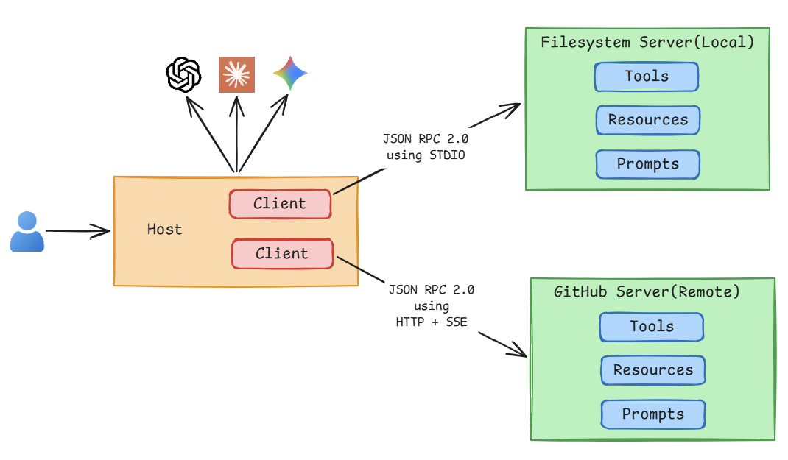

# MCP Primitives - Standard Operations

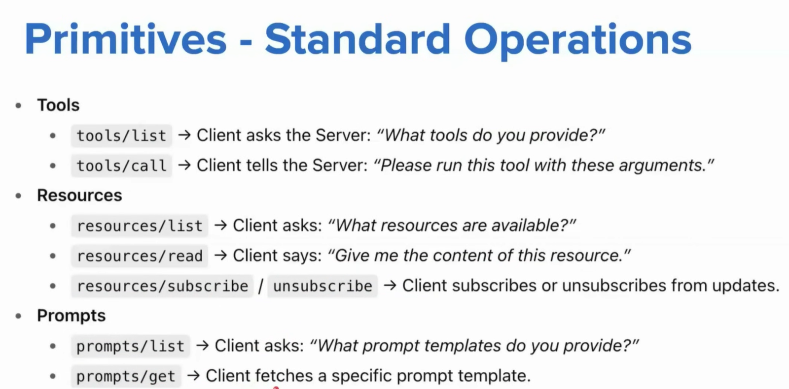

# MCP Data Layer

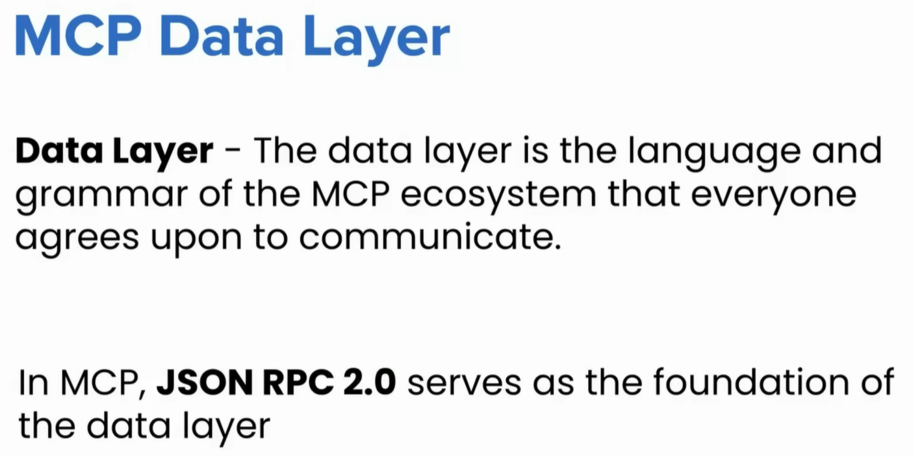

# JSON RPC 2.0

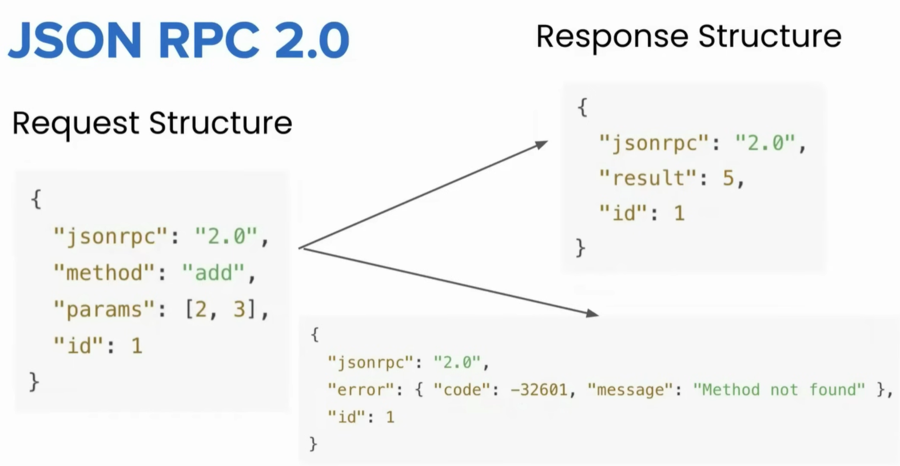

- Batching is possible in JSON RPC, i.e., sending multiple RPC calls with unique ID in a single JSON array.
- Notification (fire-and-forget client → server _or_ server → client) is possible with JSON RPC. No response expected, hence no ID is required as well. Example: subscribe and unsubscribe in resources.

# Why JSON RPC for MCP Data Layer?

Here are some reasons why JSON RPC was chosen over REST API or somthing similar -

- It is lightweight.
- It supports bi-directional communication.
- It is transport agnostic (can work with HTTP, STDIO, Web Sockets etc. unlike REST API which works over HTTP only).
- Supports batching.
- Supports notification.

# MCP Transport Layer

The **Transport Layer** is the mechanism that moves JSON-RPC messages between the Client and the Server.

The choice of transport depends on the [type of server](#mcp-server-types). If we are dealing with a local server, then the transport mechanism is **STDIO**. And, if we are dealing with a remote server, then the transport mechanism used is **HTTP/SSE**.

# MCP Server Types

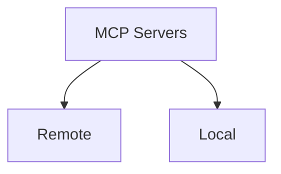

- A **local server** is a program running on the same host as the client (typically our computer).
- A **remote server** is a program running on another computer (somewhere else on the network or internet) that we connect to over a network.

## Local Servers (STDIO)

**STDIO** refers to the built-in streams every programs has access to.

- **stdin**: input the program reads.
- **stdout**: output the program writes.

In MCP, these streams are used as a transport layer between the client and the server.

### How does STDIO work in MCP?

- The host launches the server as a subprocess on the same machine/host. This creates a parent child relationship between the host and the server. Which means host gets the control of servers standard input and output.
- The host(client) writes JSON-RPC messages into the servers STDIN.
- The server reads those messages, processes them, and writes back responses to its STDOUT which the host(client) picks and uses.

## Remote Servers - HTTP + SSE

- By using HTTP the host can reach servers running anywhere.
- Host sends JSON RPC requests using POST requests with a JSON payload.
- The transport supports standard HTTP auth methods (like API keys).
- SSE stands for Server Sent Events, and its an extension of HTTP.
- Using SSE the server sends multiple messages to client over a single open connection.
- Instead of sending one large JSON blob, the server can stream chunks of data as they are ready.
- Ideal for long running tasks or incremental updates.

> [!IMPORTANT]
> The main brilliance of MCP architecture is dividing the data layer and transport layer. Making use of JSON RPC for data layer makes it compatible with any transport mechanism, and separating the transport layer gives the immense flexibility of choosing different types of transport modes available.

# MCP Lifecycle

The MCP Lifecycle describes the complete sequence of steps that govern how a host(client) and a server establish, use, and end a connection during a session.

## Stages of MCP Lifecycle

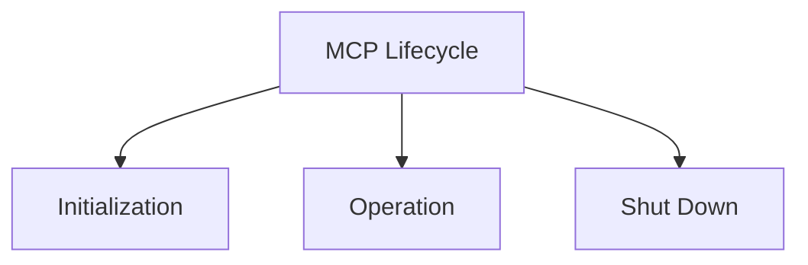

## Initialization Phase

- The initialization phase **MUST** be the first interaction between client & server.
- Establish protocol version compatibility.
- Exchange & negotiate capabilities.

### Initialization Phase - Step 1

The client sends a _initialize_ request containing something like:

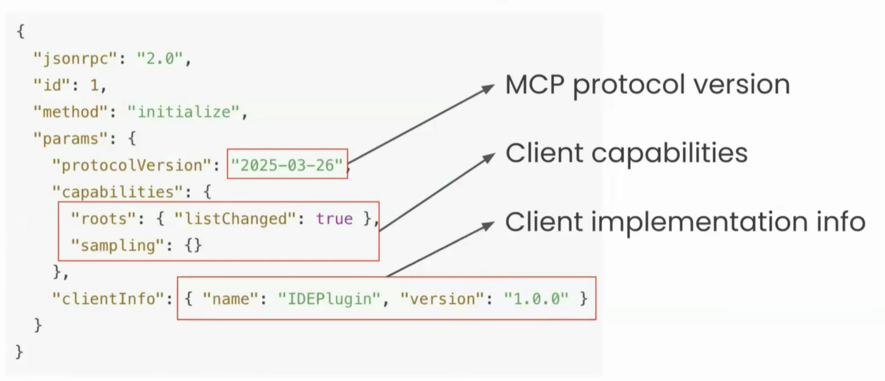

### Initialization Phase - Step 2

The server sends its own capabilities and info:

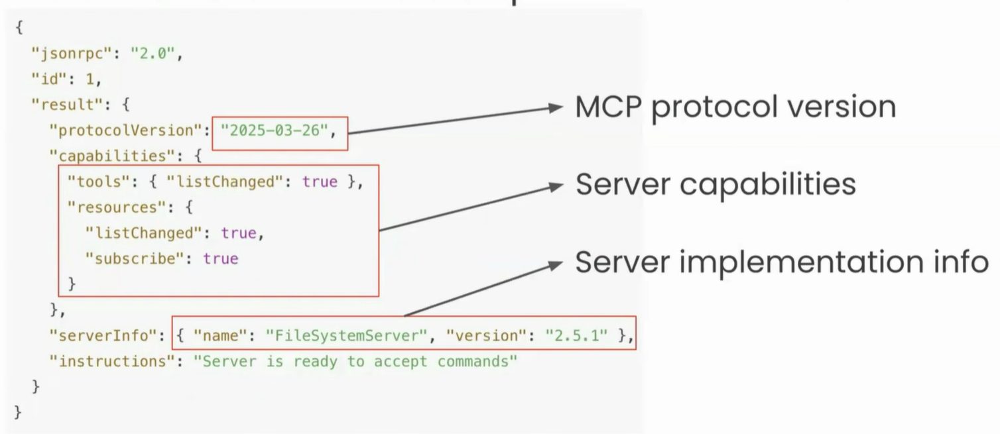

### Initialization Phase - Step 3

After successful initialization, the client **MUST** send an _initialized notification_ to indicate it is ready to begin normal operations:

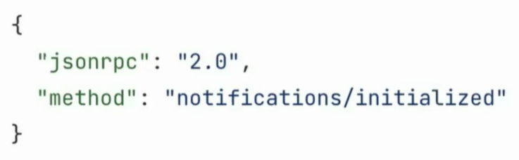

Now, the Client & Server are connected.

> [!NOTE]
> Simple analogy: TCP three-way handshake (SYN → SYN-ACK → ACK).

### ⚠️ Important Rules

- The client **SHOULD NOT** send requests other than **pings** before the server has responded to the _initialize_ request.
- The server **SHOULD NOT** send requests other than **pings** and **logging** before receiving the _initialized_ notification from client.

### Protocol Version Negotiation

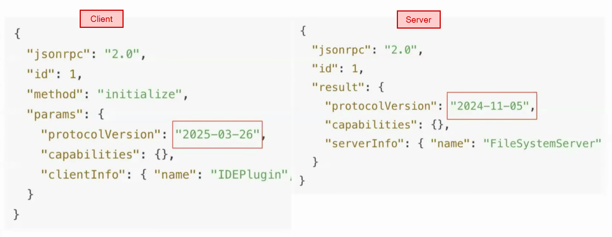

Q) What would happen when there is a difference in versions (like we can see in the image above)?

A) The client goes to its MCP config file and find out if the supported version specified by the server is supported by it or not `SUPPORTED_PROTOCOL_VERSIONS = ["2025-03-26", "2024-11-05"]`. **If the server specified version is not in its supported list of versions, client will disconnect from the server right at this stage, and will not send the final initialized notification.**

### Capability Negotiation

Client & Server capabilities establish which protocol features will be available during the session.

The major capabilities provided by client & server:

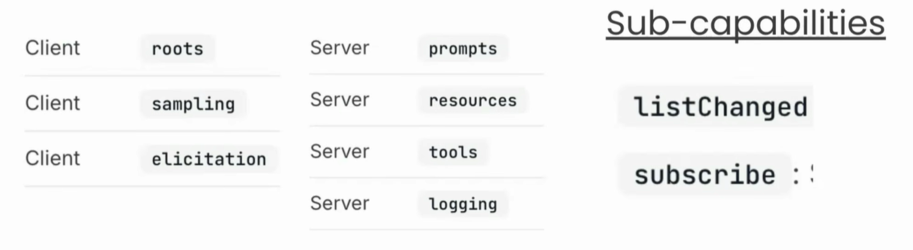

- Client `roots`: gives its root directory (working directory, like the project folder) access to server in case it needs to edit/write.
- Client `sampling`: server requests client to perform some action, e.g., making a model call.
- Client `elicitation`: server demands client to send some incomplete/missing information.
- Server `logging`: server sends logs statements to client, example: for a long running ticket booking tool call, server can periodically send logs as different tasks get complete like form filled, payment made etc.
- Sub-capabilities `listChanged`: after client connected to the server, if its capabilities changed, for example: a new tool got added or removed, server can send its updated list via this.
- Sub-capabilities `subscribe`: server sends notification if there was a change/update in resources.

## Operation Phase

- During the operation phase, the client & server exchange messages according to the negotiated capabilities.
- Respect the negotiated protocol version.
- Only use capabilities that were successfully negotiated.

We can divide the operations phase into 2 parts:

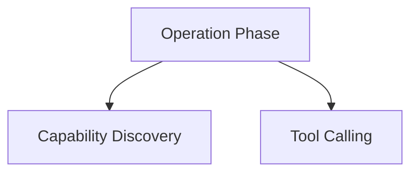

### Capability Discovery

- Here client tries to find out what specific tools, resources, prompts server can give access to it.
- The client sends JSON RPCs and hits the following methods `tools/list`, `resources/list`, `prompts/list`.
- This happens automatically immediately after initialization phase is successfully complete.
- The entire list will be shared with host by the client, and host will save it.

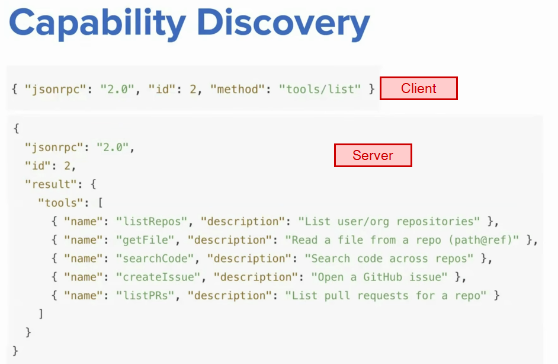

### Tool Calling

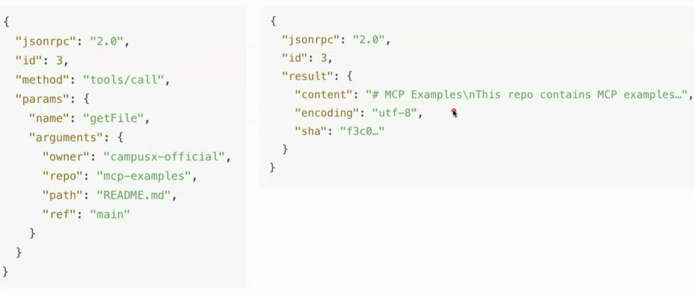

## Shutdown Phase

- Here the session going on between client & server is terminated.
- There are only 2 possible ways of shutdown - either the client stopped, or the server stopped.
- Usually it is one sided (typically the client) that initiates the shutdown.
- **No special JSON RPC shutdown message is defined.**
- **Transport layer is responsible for signalling termination.**

How transport layer handles shutdown is described below for both STDIO (local) and HTTP (remote).

### Shutdown in STDIO

- Client initiated shutdown (_usually this happens_):
  - Client closes input stream to the child process (server).
  - Wait for server to exit.
  - Send **SIGTERM** if server does not exit in time.
  - Send **SIGKILL** if still unresponsive.
- Server initiated shutdown (_rarely happens_):
  - Close output stream to the client.
  - Exit process.

### Shutdown in HTTP

- Client initiated shutdown (_usually this happens_):
  - The client (Host) **closes the HTTP connection(s)** it opened with the server.
- Server initiated shutdown (_rarely happens_):
  - The server may close the connection from its side. Not a regular scenario, but can occur.
  - The client must be prepared to detect a dropped connection and handle it (e.g. reconnect if appropriate).

## Special Cases

- The **Initialization**, **Operation**, and **Shutdown** are the regular lifecycle flows.
- There are some special flows as well which are described below.

### Pings

- Ping is a lightweight request/response method defined in MCP.
- Purpose: to check whether the other side (Host or Server) is still alive and the connection is responsive.

Sample ping request (can be sent by either client or server):

```json
{ "jsonrpc": "2.0", "id": 42, "method": "ping" }
```

Sample ping response by the other party:

```json
{ "jsonrpc": "2.0", "id": 42, "result": {} }
```

_When Ping is used?_

- It is useful for checking if the other side is up before full initialize.
- If there is no activity for a while, a client may send periodic pings. It prevents the connection from getting dropped silently by OS, proxies, or firewalls.

### Error Handling

- Error handling in MCP is how the Host (client) & Server signal that **something went wrong** with a request.
- MCP inherits JSON RPC's standard error object format.

Some common causes of error:

- Unsupported or mismatched protocol version (happens during initialization phase).
- Calling a method for a capability that wasn't negotiated.
- Invalid arguments to a tool.
- Internal server failure while processing a request.
- Timeout exceeded - client cancels request.
- Malformed JSON RPC messages.

**Error Object Structure:**

```json
{
  "jsonrpc": "2.0",
  "id": 5,
  "error": {
    "code": -32601,
    "message": "Method not found",
    "data": { "extra": "optional info" }
  }
}
```

- **`code`**: integer code that categorizes the error.
- **`message`**: short human readable explanation.
- **`data`**: (optional) extra structured data for debugging or context.

**Common Error Codes:**

| Error Code         | Name                  | Meaning                                                       | Example                                                                    |
| ------------------ | --------------------- | ------------------------------------------------------------- | -------------------------------------------------------------------------- |
| `-32601`           | Method not found      | Called a method that does not exist or was not advertised     | Host calls `prompts/list` but server never advertised `prompts`            |
| `-32602`           | Invalid params        | Request sent with wrong or missing parameters                 | Tools expect `"path": "..."`, but client sends `"file": "..."`             |
| `-32600`           | Invalid request       | Malformed JSON RPC request structure                          | Missing required fields like `jsonrpc` or `method`                         |
| `-32700`           | Parse error           | JSON could not be parsed                                      | Request body is not valid JSON                                             |
| `-32000` and above | Server-defined errors | Custom errors defined by the server (implementation specific) | Authentication failure, rate limit exceeded, quota errors, internal issues |

### Timeout

Timeout is about ensuring requests don't hang forever.

**Purpose:**

- Protects against unresponsive or overloaded servers.
- Ensures resources (memory, CPU) are not held indefinitely.
- Gives the user feedback instead of waiting forever.

**How timeout works:**

- SDKs lets client to set a per-request timeout (e.g., 30s).
- If the deadline passes with no result → client triggers a timeout.
- Client then sends a **cancellation notification** to tell the server to stop.
- The server **must stop processing** that request and **not return a result**.

Sample cancellation notification message:

```json
{
  "jsonrpc": "2.0",
  "method": "notifications/cancelled",
  "params": { "requestId": "7", "reason": "Timeout exceeded (30s)" }
}
```

### Progress Notification

- **Purpose:** let the client know a long-running request is still making progress.
- Client includes a `progressToken` in the request's `_meta`.
- Server can then send `notifications/progress` updates while working.

Sample client request (note `progressToken` in `_meta`):

```json
{
  "jsonrpc": "2.0",
  "id": 7,
  "method": "tools/call",
  "params": {
    "name": "searchCode",
    "arguments": { "query": "MCP lifecycle" },
    "_meta": { "progressToken": "tok-7" } // it can accept any value
  }
}
```

Sample server progress notifications (`id` is not needed as it is a notification):

```json
{
  "jsonrpc": "2.0",
  "method": "notifications/progress",
  "params": {
    "progressToken": "tok-7", // it will match what client sent in request
    "progress": 60,
    "total": 100,
    "message": "Searching 600 of 1000 files"
  }
}
```

# Resources

- [CampusX MCP playlist](https://www.youtube.com/playlist?list=PLKnIA16_Rmva_oZ9F4ayUu9qcWgF7Fyc0)
- [MCP Docs](https://modelcontextprotocol.io/docs/2026-07-28/getting-started/intro)
